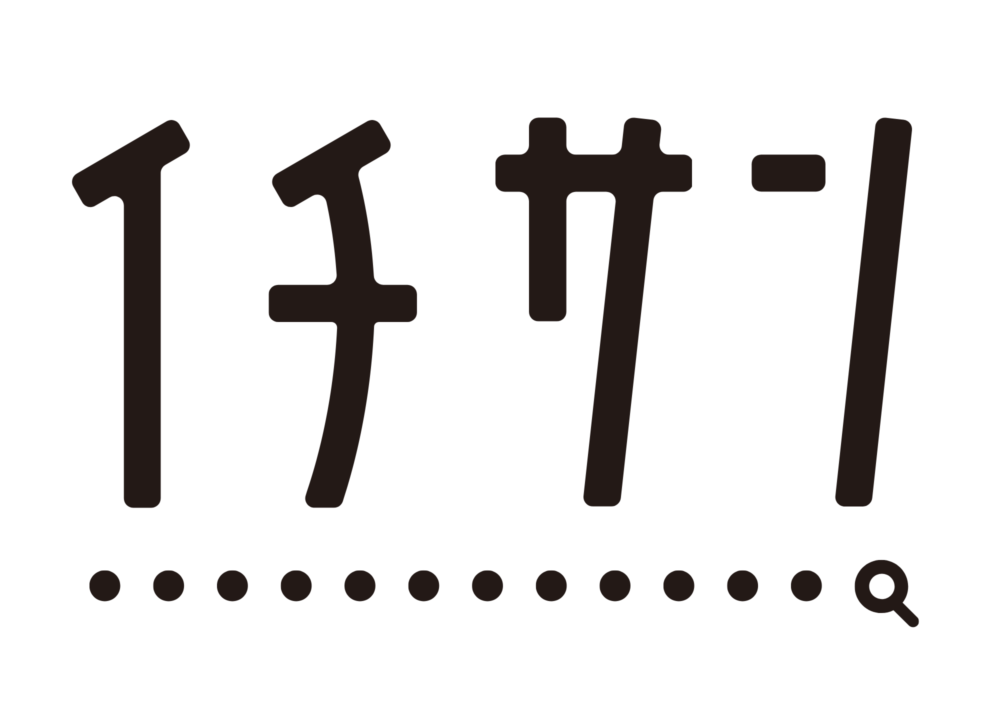

# イチサンとは？

「法人番号をもっと気軽に、便利に多くの人に利用してもらいたい」という想いから生まれたサービス群です。
法人番号株式会社が主体となり、全てのサービスを無償で提供し続ける予定です。

# 提供サービス

イチサンでは、以下のサービスを提供しています。

## イチサンSalesforce ～法人番号自動付与～

Salesforceの「取引先」および「リード」オブジェクトに対して、法人番号を自動で付与し、関連情報を効率的に管理できるようにするサービスです。新規登録・編集時の自動付与や、フォーム形式での情報登録・編集機能を提供し、法人情報の管理を効率化します。

- **申込ページ:** https://www.houjin-bangou.co.jp/ichisan-for-salesforce
- **使い方手順書:** https://bit.ly/ichisan-sf-manual

## イチサンフォーム

Webフォームに入力された法人情報を元に、法人番号やインボイス番号を自動的に補完するサービスです。会社名の一部を入力するだけで、住所や郵便番号などの情報も自動入力され、フォーム入力の手間を削減し、データの正確性を向上させます。

- **申込ページ:** https://www.houjin-bangou.co.jp/ichisan-form-beta
- **導入手順:** https://ichisan.jp/form/guide/

## イチサンクレンジング

保有している法人情報リスト（ExcelまたはCSV）をアップロードすることで、法人番号や会社名、所在地といった情報を補完・クレンジングするサービスです。テンプレートに情報を入力しアップロードする簡単なステップで、データの精度向上や名寄せ作業の効率化を実現します。

- **サービスページ・使い方:** https://ichisan.jp/cleansing/guide/

# 利用規約

サービスの利用規約については、以下のページをご確認ください。

- **イチサン利用規約:** https://www.houjin-bangou.co.jp/ichisan-legal

# 利用規約改定履歴について

# プライバシーポリシー

- [公式サイトのプライバシーポリシー](https://www.houjin-bangou.co.jp/privacypolicy)
- [本文](%E3%83%97%E3%83%A9%E3%82%A4%E3%83%90%E3%82%B7%E3%83%BC%E3%83%9D%E3%83%AA%E3%82%B7%E3%83%BC.txt)
- [改定履歴](https://github.com/Hironobu-y/ichisan-legal/commits/main/%E3%83%97%E3%83%A9%E3%82%A4%E3%83%90%E3%82%B7%E3%83%BC%E3%83%9D%E3%83%AA%E3%82%B7%E3%83%BC.txt)

改定時はこのリポジトリで本文と改定日を更新し、HubSpotの公式ページに同じ内容を反映します。公開後に両方の本文と改定日を照合します。
